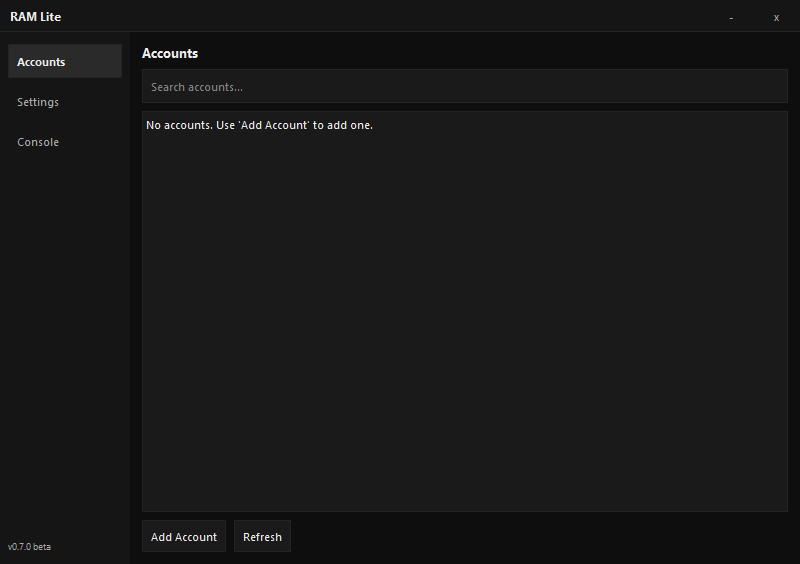
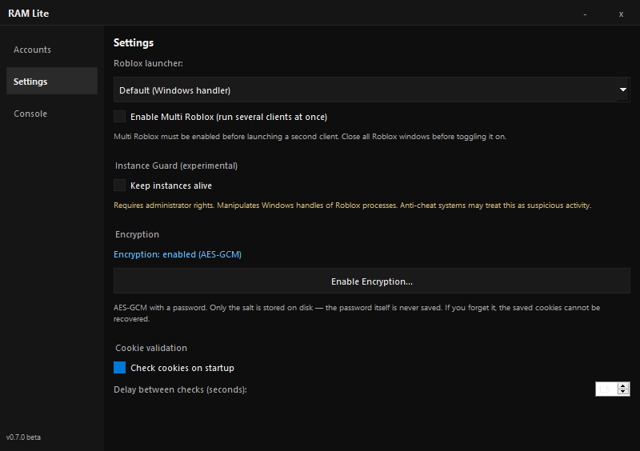

# RAM Lite

A lightweight, personal Roblox account manager for Windows 10/11.


> A personal desktop tool to store Roblox accounts, import cookies, launch multiple clients, keep them alive, and protect everything with strong encryption. Built from scratch with a focus on clean UI, working features, and honest tests.

---

## ✨ Features

- **Account management** — import `.ROBLOSECURITY` cookies, view avatars, edit notes, search, delete.
- **Encrypted storage** — AES-GCM (PBKDF2, 200k iterations) with a user password. Only the salt is written to disk.
- **Cookie validator** — checks all cookies on startup and flags expired ones with a red badge.
- **Single launch** — open Roblox Home or jump into a Place ID with one click.
- **Multi-instance** — run several clients at once via the `ROBLOX_singletonEvent` mutex trick.
- **Instance Guard** — experimental native handle cleanup that keeps multi-instanced windows from closing after the Byfron time limit.
- **Launcher support** — default Windows handler, Bloxstrap, or direct `RobloxPlayerBeta.exe`.
- **Background workers** — imports, cookie checks, avatar downloads, and launches never block the UI.
- **Custom dark theme** — frameless window, custom title bar, consistent styling across dialogs.

---

## 🖼️ Screenshots

### Account list


### Settings

---

## 📋 Requirements

- **Windows 10 or Windows 11**
- **Python 3.12** (uv installs it automatically)
- **[uv](https://docs.astral.sh/uv/getting-started/installation/)** 0.4+
- **Roblox Player** installed from [roblox.com](https://www.roblox.com)

---

## 🚀 Installation

```powershell
# 1. Clone or download the project
git clone <your-fork-url> ram-lite
cd ram-lite

# 2. Install dependencies
uv sync

# 3. Run
uv run python src/main.py
```

On first launch you'll be prompted to import your first account. For encrypted storage, open **Settings → Encryption → Enable Encryption...**.

> **Instance Guard requires administrator rights.** If you want to use it, launch the app from an elevated terminal:
> ```powershell
> Start-Process powershell -Verb RunAs -ArgumentList "-NoExit", "-Command", "cd C:\path\to\ram-lite; uv run python src/main.py"
> ```

---

## 📖 Usage

### Adding an account

1. Log into Roblox in your browser.
2. Open **DevTools** (`F12`) → **Application** → **Cookies** → `https://www.roblox.com`.
3. Copy the value of `.ROBLOSECURITY` (starts with `_|WARNING:-DO-NOT-SHARE-THIS...`).
4. In RAM Lite click **Add Account**, paste the cookie, click **Import**.

> To add a second account without logging out of the first, use an **Incognito window** (`Ctrl+Shift+N`) or a separate **Chrome profile**.

### Launching

- **Single account** — right-click → **Launch Roblox Home** or **Launch Place ID...**.
- **Multiple accounts** — `Ctrl+Click` or `Shift+Click` to select several, then right-click → **Launch N Accounts (Home)**.

### Enabling Multi Roblox

1. Close **all** Roblox windows.
2. **Settings → Enable Multi Roblox**.
3. Launch several accounts as described above.

### Instance Guard (experimental)

Keeps multi-instanced Roblox clients alive past the Byfron time limit by continuously closing the `ROBLOX_singletonEvent` handle in each process.

- Requires **administrator rights**.
- **Experimental.** Anti-cheat systems may consider repeated handle manipulation suspicious. Use at your own risk.

### Encryption

**Settings → Encryption → Enable Encryption...** — choose a password of at least 8 characters.  
Only the salt is stored on disk; the password is never saved. **If you lose the password, the saved cookies cannot be recovered.**

---

## 🧪 Tests

```powershell
uv run python scripts/run_tests.py
```

Covers `atomic_io`, `settings_store`, `roblox_api`, `account_manager`, `avatars`, `launcher`, `multi_roblox`, `cookie_validator`, and `encryption`.

---

## 🗂️ Project structure

```
ram-lite/
├── src/
│   ├── main.py                    # entry point
│   ├── classes/
│   │   ├── account_manager.py     # accounts storage + encryption wiring
│   │   ├── encryption.py          # AES-GCM + PBKDF2
│   │   ├── operation_result.py    # typed result object
│   │   └── roblox_api.py          # Roblox endpoints
│   ├── features/
│   │   ├── avatars.py             # avatar cache + fetch
│   │   ├── cookie_validator.py    # startup cookie check
│   │   ├── instance_guard.py      # native handle cleanup
│   │   ├── launcher.py            # roblox-player URL + launchers
│   │   ├── multi_roblox.py        # singleton mutex
│   │   └── settings_store.py      # cached JSON settings
│   └── utils/
│       ├── app_paths.py
│       ├── atomic_io.py
│       ├── theme.py
│       ├── ui.py
│       └── workers.py
├── tests/
│   └── unit/                      # 70+ tests, all stdlib unittest
├── docs/screenshots/
├── scripts/
│   ├── run_tests.py
│   └── build.cmd (optional)
├── pyproject.toml
└── README.md
```

---

## 🔒 Security

- Cookies grant **full access** to your Roblox accounts. Never share them.
- With encryption enabled, `accounts.json` is a base64-encoded AES-GCM blob — unreadable without your password.
- Without encryption, cookies are stored in **plaintext**. Enable encryption if you plan to keep this tool around.
- `Instance Guard` manipulates Roblox process handles. Anti-cheat systems may flag this as suspicious activity.

---

## ⚠️ Disclaimer

This project is for **personal use** and **learning purposes** only. It is not affiliated with, endorsed by, or supported by Roblox Corporation.

- Using multiple Roblox accounts or multi-instancing may violate [Roblox Terms of Use](https://en.help.roblox.com/hc/en-us/articles/115004647846-Roblox-Terms-of-Use).
- **Instance Guard** interacts with Roblox processes in ways that anti-cheat systems may consider suspicious. Using it may result in **account termination**.
- The author is not responsible for account bans, data loss, or any other consequences of using this tool.

**Use it at your own risk.**

---

## 🗺️ Roadmap

- [x] Account import from cookie
- [x] Avatar caching, notes, search
- [x] Single + batch launch
- [x] Multi-instance via mutex
- [x] AES-GCM encryption
- [x] Startup cookie validation
- [x] Instance Guard (native handle cleanup)
- [ ] Auto-Rejoin on disconnect
- [ ] Anti-AFK with per-window control
- [ ] Persist window size and last-used fields
- [ ] Batch operations (delete, notes, place ID for N accounts)
- [ ] Portable build via PyInstaller

---

## 📝 License

MIT. See [LICENSE](LICENSE) if present, or use the project freely for personal, non-commercial purposes.

---

## 💬 Contributing

Issues and pull requests are welcome — but keep in mind this is a personal project. If you're adding a feature, please also add a test.

